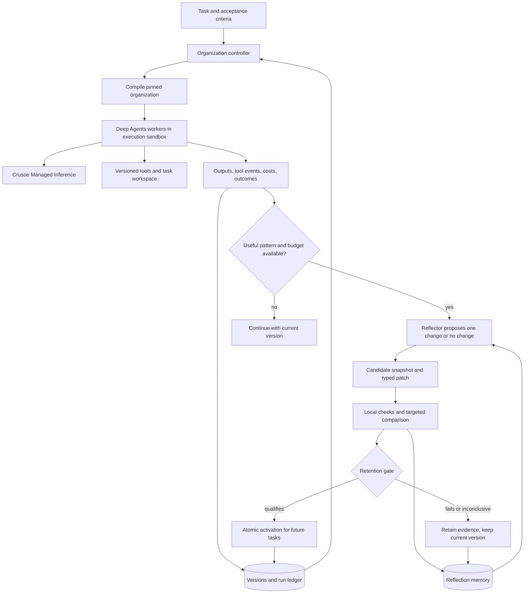

# Persistent agent organizations with evaluated reflection

Status: proposed implementation, 2026-10-17. Primary hackathon track: **Version N+1**. Companions: [proposal](../PROPOSAL.md) and [research notebook](../RESEARCH.md).

Steps 1–4 now provide the Crusoe/Deep Agents integration, persistent execution, a local viewer, separate reflection memory, typed proposals, paired evaluation, atomic activation, and optional specialist compilation. See the [implemented commands and limits](../README.md) and [Step 3 evidence](STEP3_RESULTS.md). Live comparisons produced conflicting results for equivalent candidates, so an activation was revoked and v0 remains active. The frozen held-out audit scored 0/4 executions for both branches across two distinct tasks; no performance gain or successful transfer is claimed. The local UI supports chat with the active topology and explicit reflection triggering. See [Step 4 evidence](STEP4_RESULTS.md). Broader workflow scheduling, generated tools, sandbox deployment, and several optimization mechanisms below remain proposed.

## 1. Decision

Persist an organization's **execution configuration**: its memory, prompts, skills, tools, roles, and handoffs. Instantiate workers from that configuration for each task. Record outcomes after each task, then trigger bounded reflection only when accumulated evidence and the remaining budget justify it. Reflection proposes an immutable candidate version. Independent checks and a targeted comparison determine whether it qualifies for activation; a full benchmark is reserved for milestones and final evaluation.

**Version 0 is one capable generalist agent that can spawn temporary subagents as needed.** It starts with seed prompts, skills, tools, and memory plus a bounded delegation policy. There is no predetermined planner/implementer/reviewer team. Reflection observes the generalist's actual work and can retain useful specialist definitions, conditional handoffs, procedures, or tools. Future tasks still begin at the generalist, which can use retained specialists or create new temporary ones. A version may improve while retaining exactly one persistent role.

Maintain a separate **reflection memory** about attempted improvements and their measured outcomes. Task memory helps agents do the work; reflection memory helps the improvement loop select its next experiment. Both can use the same SQL database with separate records and access scopes. Neither requires model fine-tuning.

The hypothesis is that retaining tested procedures and divisions of labor improves recurring work or reduces its cost. More agents and more elaborate topology are not success criteria. Reflection must be able to choose a memory correction, a better procedure, a tool, a simpler organization, or no change.

Use Python, **LangChain's Deep Agents framework** (`deepagents`, with `create_deep_agent`), and SQLite for the core. References to the "Deep Agents SDK" below mean this same LangChain framework. Use Crusoe Managed Inference for model calls. Treat NemoClaw/OpenShell as the execution and deployment integration; keep our organization controller separate from the managed agent harness. Section 2 describes the verified integration boundaries and the remaining smoke tests.

Reuse the framework's agent loop, tools, subagents, skills, middleware, and state facilities. Our controller is application code around that framework: it supplies versioned organization configuration, enforces required handoffs, and implements reflection, comparative evaluation, adoption, and rollback. It does not replace Deep Agents or rebuild its agent loop. The distinction below concerns the programmable framework versus NemoClaw's packaged Deep Agents Code application. [LangChain framework customization](https://docs.langchain.com/oss/python/deepagents/customization).

The first deliverable is one complete lifecycle on an objectively scored task family: execute → reflect → evaluate → retain or reject → restart with the retained configuration → roll back. Support all five mutation types in the data model; demonstrate the ones that earn a measurable benefit.

## 2. Sponsor stack and feasibility

**Feasible, with a distinction between the managed Deep Agents Code application and the programmable Deep Agents SDK.** NVIDIA currently documents NemoClaw support for Deep Agents Code through `nemo-deepagents`. Its quickstart supports custom compatible inference endpoints. This establishes an integration path, but our exact Crusoe/model/runtime combination still needs a live test. [NVIDIA quickstart](https://docs.nvidia.com/nemoclaw/latest/user-guide/deepagents/get-started/quickstart).

| Layer | Proposed responsibility | Implementation boundary |
| --- | --- | --- |
| Crusoe Managed Inference | Model calls for workers, reflection, and any model-based verification | Use the supported Chat Completions endpoint and discover a current model. |
| Crusoe Linux VM, optional initially | Host controller, SQLite, and sandbox services | Separately provisioned compute; local development can call the same inference API. |
| NemoClaw / OpenShell | Provision managed workers and enforce execution/network boundaries | Verify the chosen runtime's restrictions before promising autonomous script execution. |
| LangChain Deep Agents framework / SDK | Construct workers with explicit model, prompts, skills, tools, and permitted subagents | Compile each pinned organization version into SDK configuration. |
| Our controller | Persistence, scheduling, reflection, scoring, adoption, rollback, budgets | This is the project's main implementation. |
| Our extension modules | Typed tools, memory access, trace collection, mutation proposals | Implement in Python; expose selected capabilities through MCP if using managed workers. |

Crusoe's current documented inference base URL is `https://api.inference.crusoecloud.com/v1`, authenticated with an Intelligence API key. A VM is a separate infrastructure resource. The supplied event guide offers $50 in inference credits; it does not establish VM credit coverage. Remote inference means our application does not inherently require its own GPU. [Inference setup](https://docs.crusoecloud.com/quickstart/getting-started-with-serverless-inference/index.html), [VM setup](https://docs.crusoecloud.com/quickstart/creating-a-vm/index.html).

LangChain exposes custom models, prompts, tools, memory paths, skills, subagents, backends, and middleware through `create_deep_agent`. These are suitable extension points for our controller. Its filesystem/checkpoint facilities are runtime mechanisms; our version manifest remains the authority for which organization is active. [SDK customization](https://docs.langchain.com/oss/python/deepagents/customization), [backend choices](https://docs.langchain.com/oss/python/deepagents/backends).

NemoClaw does not currently expose a public plugin SDK for arbitrary platform extensions. “Custom plugins” in this design means our Python modules, agent skills, or supported MCP services. We should not assume an OpenClaw plugin can be loaded into Deep Agents. [NVIDIA extension taxonomy](https://docs.nvidia.com/nemoclaw/latest/user-guide/deepagents/reference/extension-taxonomy-sdk-readiness).

The managed `dcode` runtime constrains model configuration and extensions. In particular, headless operation disables shell execution and executable hooks; managed MCP requires registered HTTPS services, and project/user subagents inherit the configured model. This matters for generated tools and automated coding evaluations. A managed-worker implementation must delegate test/script execution to an explicitly configured service. Do not patch the managed launcher to remove its restrictions. [Managed runtime behavior](https://docs.nvidia.com/nemoclaw/latest/user-guide/deepagents/manage-sandboxes/operate-sandboxes/run-deep-agents-code).

For the full programmable design, package our SDK worker in a custom OpenShell image. OpenShell documents custom container images and commands; this supports our deployment approach, but does not certify this particular Python harness or its Crusoe route. Our SDK worker is a custom OpenShell workload, not NemoClaw's managed Deep Agents Code runtime. Our adapter owns its model routing, dependencies, startup, and tracing. Keep the controller, database, evaluator, and sandbox lifecycle authority on the trusted host. Candidate code and task commands execute only in worker or evaluation sandboxes. [OpenShell sandbox workloads](https://docs.nvidia.com/openshell/latest/how-it-works/sandboxes/overview).

Recommended sequence: prove the SDK controller against Crusoe first, then integrate its execution adapter with OpenShell. If using the NemoClaw managed image is a priority, test one headless worker plus one registered tool service before building the reflection loop. Neither deployment path has been executed in this checkout.

### Integration exit criteria

Complete these before expanding the implementation:

1. Discover available models with `GET /v1/models`; select one that supports the required tool calling and output format. Record its ID, capabilities, date, and runtime package versions. Select a Nemotron model if it passes these checks and serves the demo well; model availability alone is insufficient. [Crusoe capability discovery](https://support.crusoecloud.com/hc/en-us/articles/55002524169499-How-To-List-Model-Features-via-curl-and-the-Inference-API).
2. Execute one Deep Agents task through Crusoe, including a tool call and one child worker. Explicitly pass the same model route to every worker; verify reflection calls use Crusoe too.
3. Run the same task through the selected sandbox adapter. Verify working-directory access, tool results, network routing, cancellation, and usage capture.
4. Execute an objective test in a disposable workspace. If managed headless workers cannot run it directly, prove the configured tool-service path.
5. Restart the controller and load the same organization digest from durable storage.

Pin the SDK, adapter, gateway, and image as one tested integration after this spike. When using NemoClaw, preserve its managed dependency versions instead of independently upgrading OpenShell or assuming commands from a different release apply. [NemoClaw prerequisites](https://docs.nvidia.com/nemoclaw/latest/user-guide/openclaw/get-started/prerequisites). Keep a global limiter across all agents and charge retries to the experiment budget. Current per-project/per-model limits and capacity errors are documented by [Crusoe](https://docs.crusoecloud.com/serverless-inference/rate-limits/index.html); query or configure the account's actual limits rather than embedding tutorial assumptions.

## 3. Architecture and ownership



The controller owns persistent writes and the active-version pointer. Workers receive a read-only snapshot and a writable task workspace. They may submit observations or candidate artifacts, but cannot directly replace active skills, prompts, memory, tools, or topology.

Credentials, infrastructure policy, resource ceilings, evaluator code, and retention thresholds are controller-owned. Reflection cannot modify them. The reflector's own prompt is pinned as experiment configuration in the MVP; recursive changes to the optimizer are deferred.

For the initial implementation, one controller process schedules tasks, serializes persistent writes, and admits at most one candidate evaluation at a time. Independent worker steps may run concurrently within its limits. Multiple hosts, distributed scheduling, and arbitrary workflow cycles are deferred.

## 4. What persists

An organization is a manifest of immutable component revisions. A role has a stable identity across tasks; a worker is one temporary instance of that role. Saving a topology does not require keeping model sessions alive. In v0, the topology catalog contains the generalist entrypoint and its delegation policy. The call trees it creates during individual tasks belong to run history. A retained specialist is a reusable definition with an activation rule, not an always-running additional agent.

| Component | Persisted fields | Reflection may change | Component checks |
| --- | --- | --- | --- |
| Memory | Claim, scope, source references, verification status, observed time, validity, superseded claim | Add, correct, consolidate, expire; adjust scoped retrieval rules | Evidence supports claim; no silent conflict; scope and freshness match |
| Prompts | Instruction templates, variables, role output contracts, assembly revision | Clarify instructions, remove ambiguity, revise output requirements | Render successfully; compatible schema; preserve controller instructions |
| Skills | Applicability, input/output contract, procedure, references, checks | Add a missing step, simplify or consolidate procedures | Valid references; applicable fixture; checkable result |
| Tools | Input/output schema, code digest, dependencies, declared effects, runner type, tests | Add or repair a deterministic helper, retire an unused tool | Tests pass in actual runner; effects remain within policy |
| Topology | Generalist entrypoint, spawn policy, reusable role inventory, conditional step assignments, handoffs, completion authority | Retain a recurring specialist, reassign a role or edge, change routing or review ownership | References resolve; configured DAGs valid; required steps reachable; contracts compatible |

A role references prompts, skills, tools, and memory scopes by logical ID. The compiler resolves those IDs exclusively through the pinned manifest's catalogs and records the resulting exact revisions in the execution plan. Replacing a prompt catalog therefore changes the effective worker prompt without needing a structural topology edit. Unresolved or incompatible bindings fail compilation; no global `latest` lookup is allowed. Instructions describing what a reviewer checks belong in its prompt/skill. The rule requiring that reviewer before completion belongs in topology.

Illustrative manifest; identifiers and digests below are placeholders:

```json
{
  "schema_version": 1,
  "organization_id": "personal-company",
  "version_id": "org-v12",
  "parent_version_id": "org-v11",
  "components": {
    "memory": "memory-r8",
    "prompts": "prompts-r4",
    "skills": "skills-r7",
    "tools": "tools-r3",
    "topology": "topology-r5"
  },
  "manifest_digest": "sha256:<canonical-content-digest>",
  "provenance": {"candidate_id": "candidate-12", "evidence_run_ids": ["run-31", "run-34"]}
}
```

The component catalog pins exact artifact revisions and hashes. Compute the manifest digest over the defined canonical payload excluding its own digest and nonsemantic timestamps. Do not resolve `latest` references while executing. Runtime build, model settings, policy revision, task fixtures, and evaluator revision are pinned separately on each run/evaluation record.

### Memory admission and context assembly

Raw transcripts and outcomes are evidence, not automatically trusted memory. A worker writes observations to its run ledger. Reflection proposes curated claims with source event IDs. A deterministic check can establish provenance for an explicit user fact or a verified tool result; inferred lessons need additional supporting evidence. Every reflected memory candidate still passes the retention process before activation. Current user instructions apply directly as controller constraints, independently of whether reflection later retains a reusable memory.

Use project scope plus optional role/task tags. Conflicting claims become explicit alternatives or a source-supported supersession, never last-write-wins text. Expiry filters a claim out of retrieval; the historical revision remains auditable. Record the retrieval timestamp and exact retrieved item revisions so a later expiration does not obscure what a run saw.

For the MVP, retrieve scoped text with a fixed token cap and deterministic ranking/tie breaks. A vector service is unnecessary initially. Render a bounded memory document for Deep Agents and materialize skills in a read-only version directory. Any proposed memory write goes to staging, not those active files. Deep Agents supports filesystem skill directories; our controller supplies their exact pinned contents. [Skills documentation](https://docs.langchain.com/oss/python/deepagents/skills).

Context assembly order is controller constraints, role instructions and output contract, applicable procedures, retrieved factual context, and task/handoff data. Retrieved text cannot grant capabilities. Record artifact IDs, rendered-prompt digest, tool definitions, and retrieval results with each worker invocation.

### Reflection memory

Keep the improvement loop's memory separate from task memory. Use the same database initially, with separate tables/scopes and retrieval paths:

| Memory | Main reader | Contents |
| --- | --- | --- |
| Task memory | Generalist and its workers | Project facts, user preferences, verified lessons useful for completing work |
| Reflection memory | Reflector and experiment planner | Past proposals, evaluation outcomes, recurring failure/delegation patterns, costs, uncertainty, and reasons for retention or rejection |

The controller appends an experiment record after each proposal and evaluation attempt. Fields include organization and experiment ID, base/candidate digests, change family, task slice, evidence references, suite and runtime configuration, measured quality/cost differences, total adaptation expense, outcome, and limitations. Distinguish `rejected`, `inconclusive`, `invalid`, and `deferred_budget`; lack of evaluation is not evidence that an idea failed.

Keep these records append-only. Derived lessons are versioned summaries linked to the original records, with scope and uncertainty. For example, a reviewer that increased cost without improving a tested task slice is evidence against that particular configuration on that slice, not a universal rule against reviewers. Corrections supersede summaries without erasing the measurements.

Before proposing, retrieve a bounded set of relevant attempts and unresolved patterns. Prefer matching task slices, component families, and compatible runtime versions. Use these to avoid duplicate experiments, choose cheaper alternatives, and revisit old ideas when new evidence changes their context. Similarity and prior success guide search; the independent retention gate still decides activation.

Recording an evaluation result does not itself need another evaluation or model call. Structured measurements come directly from the evaluator; optional narrative consolidation is batched and charged to reflection. A reflection run pins its memory cutoff/retrieved record IDs, prompt, and model configuration so its proposal is auditable. Workers do not read this memory automatically; a useful project fact requires a separate task-memory proposal.

An organization rollback preserves reflection history, including why the rolled-back version was abandoned. Experiment namespaces prevent unrelated runs from leaking evidence into comparisons. Final held-out outcomes remain outside reflection memory while that benchmark is used to establish transfer. If later used for learning, retire that benchmark and reserve a fresh held-out set. The MVP learns through accumulating and retrieving this history; changing the reflector's own prompt, model weights, evaluator, or acceptance rules is outside this loop.

## 5. Persistence, activation, and recovery

Use a single SQLite database for small artifact contents, manifests, run events, and decisions. Storing the initial tool source and text artifacts in the database avoids coordinating filesystem writes with activation. Materialized files are digest-checked caches. Large attachments can move to content-addressed storage later.

SQLite provides atomic transactions; explicitly enable foreign keys on every connection. Start with a single writer and the standard rollback journal. WAL is optional after deployment testing; it requires same-host access and is not a distributed database solution. [Atomic commit](https://www.sqlite.org/atomiccommit.html), [foreign keys](https://www.sqlite.org/foreignkeys.html), [WAL constraints](https://www.sqlite.org/wal.html).

| Table | Essential fields and invariant |
| --- | --- |
| `artifact_revisions` | Organization, kind, logical ID, revision ID, digest, content, provenance; immutable |
| `organization_versions` | Organization, version ID, parent, manifest, digest, schema version; immutable |
| `version_artifacts` | Explicit membership/references for each version; foreign keys validate existence |
| `active_organization` | Organization, version ID, monotonically increasing generation |
| `activation_events` | Previous/next version, generation, candidate/evaluation, reason, timestamp |
| `runs` | Purpose, pinned version, task/fixture digest, runtime/model/policy, status, budget, actual usage |
| `worker_instances` | Run, instance, role revision, parent instance, delegated scope, depth, status |
| `run_events` | Run, sequence, event type, payload/artifact reference; unique ordered sequence |
| `candidates` | Base version and generation, patch, proposed version, evidence, state |
| `evaluations` | Candidate/base digests, suite split/revision, evaluator, thresholds, run IDs, results |
| `reflection_records` | Organization/experiment, proposal/evaluation references, task slice, configuration, measured outcomes/costs, status; append-only |
| `reflection_lessons` | Versioned summary, source record IDs, applicability, uncertainty, supersession; derived evidence, not an acceptance rule |
| `reflection_runs` | Memory cutoff/retrieved IDs, evidence selection, prompt/model configuration, proposal or no-change result, usage |
| `budget_reservations` | Experiment, call/attempt ID, phase, reserved cost, actual usage, settlement state |

Scope references by organization. Enforce foreign keys and uniqueness in storage; use application validation for graph/schema semantics. Disallow runtime UPDATE/DELETE of immutable revisions. Record schema migrations explicitly; a migrated organization is a new version rather than a silent rewrite of historical manifests.

Activation is one short transaction that verifies the qualifying evaluation refers to the exact candidate, current policy, base version, and generation; conditionally advances the pointer; then writes the activation event. Also require the same experiment-configuration digest covering runtime build, model settings, evaluator, and thresholds. A configuration change invalidates qualification until re-evaluation. Check the affected row count before committing:

```sql
UPDATE active_organization
SET version_id = :candidate_version,
    generation = generation + 1
WHERE organization_id = :organization_id
  AND version_id = :evaluated_base
  AND generation = :evaluated_generation;
```

If zero rows change, the candidate is stale. Rebase and re-evaluate it; do not silently merge. Checking generation as well as version catches a version that changed away and was later rolled back. In-flight runs continue with their original snapshot.

Full rollback points future runs at a previously retained, still-policy-compatible version and appends an activation event. It preserves all later evidence. A component rollback constructs a new candidate and checks dependencies. Neither operation reverses external side effects performed by tasks.

On restart, load the last committed active version. A process lock prevents a second MVP controller from claiming the same work. Mark unfinished runs interrupted; retain outputs and unresolved tool-call intents. The MVP does not resume live model sessions. A new attempt is a new run linked to the interrupted one. Never blindly repeat a tool call whose external effect is unknown. Persist call IDs and intent/completion events now to support future recovery.

## 6. Topology execution and temporary workers

Start v0 with a single persisted generalist entrypoint. It receives the goal, chooses how to work, and can spawn bounded temporary children with task-specific instructions. It remains responsible for the final answer and objective acceptance checks. Its runtime call tree is recorded as evidence; it is not automatically a saved workflow.

Later versions may retain specialist definitions and conditional workflows observed across tasks. Saving a specialist gives the generalist a reusable option. Making a handoff mandatory is a separate topology change that needs evidence. Unrelated tasks still use the generalist's default path, and new temporary delegation remains available in every version.

Represent retained workflows as bounded DAGs. Each step binds a role revision, input/output schema, activation rule, and attempt limit. An edge identifies an artifact handoff and whether it is a prerequisite or required review. One designated completion step determines the final task result. The single generalist step is the simplest valid graph.

For example, reflection might propose a compatibility reviewer only for public-interface changes. This is an illustrative possible evolution, not part of v0. If review fails, the controller may start one bounded repair attempt using an explicitly configured repair schedule. It does not add an unbounded back edge. A repeated role can appear in multiple step instances without creating a new permanent role. Reviews bind to exact artifact digests. A repair invalidates every downstream result that depended on the replaced artifacts and reruns required reviews before finalization.

The compiler checks that every required step can reach completion and every required review is on the relevant completion dependency path. A step starts only after its required inputs are validated. Fan-in names the exact input artifacts; it does not concatenate every worker transcript. MVP activation rules use validated task tags and explicit output fields, not arbitrary generated code. A conditional route must include a valid fallback and cannot drop a required check.

Deep Agents subagents provide delegation primitives, but any retained mandatory reviews and ordering are enforced by our scheduler. Listing a reviewer in `subagents` does not by itself require its invocation. Preserve generalist-directed delegation and wrap all child dispatch through the same budget and capability checks. [Subagent configuration](https://docs.langchain.com/oss/python/deepagents/subagents).

Temporary children have a parent, scoped assignment, permitted tools/context, and depth. They share the run's budget and report to their parent. Parent completion joins or cancels its children. Their roles and edges appear in the trace but never automatically enter the persistent topology. Reflection can propose retaining a useful recurring specialist and test whether it earns its overhead.

Initial configurable ceilings: 30 model calls, 30 executable tool calls, 8 total spawns, depth 2, and 2 attempts per step. Require finite input/output-token and wall-time ceilings before the first live call, then calibrate them with the smoke test. These are upper bounds, not targets; use smaller caps for the demo workload. Count nested agents, model retries, context summarization, and failed calls.

One experiment budget ledger covers execution, reflection, and evaluation. Before dispatch, atomically reserve the conservative cost of the bounded input, maximum billable output, and tool fee using the recorded provider pricing configuration. Settle against returned usage; retain the reservation for an ambiguous timeout until reconciled. Every retry needs a reservation, including SDK retries. If pricing or usage cannot be bounded, stop admission rather than claiming an enforced dollar ceiling. The account's provider-side billing limit remains separate.

Terminal outcomes include `succeeded`, `failed_checks`, `budget_exhausted`, `timed_out`, `interrupted`, and `blocked_external`. An agent saying “done” is not a successful outcome unless the task's acceptance checks pass. Repeated identical tool calls or unchanged failing outputs consume a bounded retry allowance, then stop or follow the configured repair schedule.

## 7. Reflection contract

After each completed learning run, extract a small structured record from existing events and acceptance checks without requiring another model call. Track failure codes, expensive/repeated operations, temporary roles, handoffs, outcomes, and usage. A fixed trigger can reflect after a batch or a recurring checked failure; after-every-run reflection remains a configurable demo mode. The trigger itself is ordinary code.

When triggered, combine selected task evidence with relevant reflection memory. Propose at most one candidate or return `no_change`; remember prior rejected and deferred attempts. Frequency of a temporary role is a reason to investigate it, not automatic proof that retaining it will help. Keep the prototype straightforward and permit its measured overhead for now. The [reflection cost optimization plan](REFLECTION_COST_PLAN.md) defines how to reduce that overhead after the first complete lifecycle works.

| Observed problem | First candidate family | Example |
| --- | --- | --- |
| Missing, stale, or conflicting project fact | Memory | Retain a verified compatibility requirement with its source |
| Ambiguous instructions or malformed deliverable | Prompt | Require explicit evidence for each reported defect |
| Repeatedly omitted procedure step | Skill | Add caller checks to the API-change procedure |
| Repeated computation or mechanical execution failure | Tool | Add a tested interface-diff helper |
| Correct work reaches the wrong agent, review is skipped, or ownership is duplicated | Topology | Require compatibility review before finalization |

This table guides diagnosis; it is not a deterministic causal classifier. Reflection should consider cheaper alternatives and successful improvisations as well as failures.

Every proposal must include:

```text
base_version_id, base_generation
evidence_run_ids and event references
reflection_memory_cutoff and retrieved_record_ids
observed_problem, causal_hypothesis, applicable_task_slice
primary_family, affected_components, typed_operations
expected_effect, possible_regressions, cheaper_alternatives
validation_case_ids, requested_checks, estimated_evaluation_budget
```

Suggested case IDs and checks are advisory. The controller selects the required regression cases and relevant task slice under a predeclared evaluation policy; a proposal can add cases but cannot narrow its acceptance gate.

Use typed operations such as `replace_prompt`, `revise_skill`, `supersede_memory`, `register_tool`, `add_role`, `bind_skill`, and `replace_edge`. Each operation states the expected old revision. Reject changes to controller-owned fields or unresolved references.

Prefer one causal hypothesis per candidate. Adding a reviewer may require a role, prompt, skill binding, and edges together; store them as an atomic dependency bundle. Its measured effect is a joint intervention until ablations isolate the components. Rejecting a candidate preserves its proposal and evidence without exposing its artifacts to subsequent production runs.

Proposed state machine:

```text
draft → structurally_valid → evaluating → qualified → retained
  └ invalid                   └ rejected      └ stale
```

`retained` is historical eligibility, not “currently active”; the active pointer is separate. A candidate without sufficient evaluation budget is marked `deferred_budget` and may later resume from structural checks if its base remains valid. Evaluation interruption leaves a resumable evaluation record or an explicit failed attempt, never a qualifying result.

## 8. Evaluation and retention

The evaluator is separate from the reflector and inaccessible to candidate modification. Prefer executable acceptance checks. For subjective cases, use a fixed independent rubric and report the limitations of model judging. Reflection may suggest additional tests, but it cannot replace the existing suite or lower the acceptance threshold.

Apply these gates in order. The first two require no agent replay, although executable tool checks still have a measured compute cost:

1. **Structural:** all revisions exist, contracts match, graph is valid, mandatory checks remain, and resource/capability limits hold.
2. **Component:** memory provenance/conflicts, prompt rendering, skill fixtures, and tool tests pass. Run generated code in the actual isolated runner with declared dependencies and resource limits. A timeout alone is not isolation.
3. **Targeted paired behavior:** start with a small, controller-selected validation slice plus fixed regression cases. Run current and candidate versions against the same tasks, model configuration, budgets, and initial workspace state. The changed memory/skill/tool components differ only as specified by the candidate. Each case gets its own scratch environment; neither branch learns between cases. Broader changes require broader coverage under the declared policy; if that is unaffordable, defer them.
4. **Retention:** all hard checks pass and the predeclared quality/cost criterion is satisfied. Inconclusive evidence retains the incumbent.
5. **Atomic activation:** retain exactly the evaluated digests, subject to the base/generation check in section 5.

For a small demo suite, use a transparent heuristic: no per-case acceptance regression on the selected cases, plus at least one newly passed case without exceeding the configured cost ceiling; or unchanged pass outcomes with a predeclared minimum cost reduction. Set the cost reduction threshold before evaluation. Store the exact coverage with the decision. This is an operational gate, not proof of general improvement or absence of regressions elsewhere. Evaluate noisy outcomes with repeated paired runs when the budget permits; otherwise keep an inconclusive candidate inactive.

For the MVP, use fresh paired runs on a fixed small suite. Larger milestone checks and the final held-out evaluation are separately budgeted. Exact reuse of eligible incumbent measurements, incremental case selection, and smaller proposal models are later optimizations described in the cost plan; they must not weaken or silently change the acceptance policy.

Every tool candidate includes source, schema, dependency digest, fixtures, and an effect declaration. Keep generated MVP tools limited to computation and disposable workspace effects. New privileges are outside reflection's mutation authority. Tool tests run through a fixed executor; a candidate cannot approve its own code by returning `passed: true`.

### Learning, validation, and unseen tasks

For the one-hour prototype, use the order-normalization workload in `fixtures/orders`: structured inputs, explicit decimal/formatting rules, and a deterministic exact-output grader. It has two learning, two validation, and two held-out cases. This tiny suite checks the learning lifecycle and does not support broad performance claims. Repository-maintenance tasks remain a later extension. Start each case from isolated task state so earlier outputs do not carry over.

Partition tasks before learning into learning, candidate validation, and final held-out sets. The reflector sees learning traces and bounded validation feedback, never final task contents or answers. Freeze all five learned components and disable reflection before the final comparison. Every final task starts from that frozen snapshot and an isolated workspace; its outcomes cannot become task memory, reflection memory, or another candidate. Reusing a validation set repeatedly can overfit it, so cap candidate attempts and report how often it was queried.

Record per-task acceptance, total and execution-only inference cost, tool cost where relevant, wall time, calls, and worker count. Include reflection and failed candidate evaluations in adaptation expense. Report paired task differences and uncertainty when the sample permits. A scripted/offline lifecycle demo verifies plumbing only.

### Baselines and attribution

For the hackathon, compare frozen **v0 (one generalist with on-demand temporary subagents)** against the frozen retained version on the same unseen tasks, with full cost disclosure. Both retain the same ability to create temporary workers; v0 is not artificially restricted to working alone. This comparison measures the combined learned configuration, not topology alone. For the broader hypothesis, add:

| System | What can improve during learning |
| --- | --- |
| Memory-driven planner | Memory, prompts, skills, generated tools, and reusable organization descriptions; transient teams per task |
| Fixed organization | The same nonstructural assets; the persistent layout stays at v0's generalist and spawn policy, while task-local delegation remains available |
| Evolving organization | All five components within the same policy and budget |

Give each learning system equivalent models, tools, starting information, reflection opportunities and history, temporary spawning, and total budgets. All start from the same generalist seed configuration. Do not credit topology for a generated tool that only one system was allowed to create.

Run component ablations as budget permits. For edge wiring, retain learned role definitions, prompts, memory, skills, and tools while restoring compatible original edges. Test role inventory changes separately. A full-version rollback demonstrates recovery but does not isolate topology's contribution. If dependencies make a component swap invalid, report a joint effect or an unavailable ablation instead of inventing a comparison.

Report the execution savings and the task volume needed to recover adaptation cost. If there is no execution saving, there is no cost break-even to claim. A gain over the initial organization alone does not establish superiority to a strong memory planner or prior research.

## 9. Interfaces and project layout

These are proposed interfaces, not commands already implemented:

```python
store.load_active(organization_id) -> (OrganizationVersion, generation)
compiler.compile(version, task, runtime_policy) -> ExecutionPlan
runner.execute(plan, environment, budget) -> RunResult
reflector.propose(version, evidence, reflection_memory_view, budget) -> Candidate | NoChange
validator.compare(candidate, suite, experiment_config) -> EvaluationReport
store.activate(candidate_id, expected_version, expected_generation) -> Activation
store.rollback(target_version, expected_generation, reason) -> Activation
```

`RunResult` contains output artifacts, objective check results, evidence references, usage, and a terminal reason. `EvaluationReport` pins both versions, task splits, all run IDs, evaluator configuration, and the gate decision. Model aliases and external tools can still change upstream; version records support audit and controlled reruns, not a promise of deterministic model replay.

```text
src/company/
  schemas.py                 # Manifest, roles, steps, candidates, outcomes
  store.py                   # SQLite revisions, events, activation, rollback
  compiler.py                # Resolve component bindings and validate the DAG
  runtime.py                 # Scheduling, budgets, joins, terminal outcomes
  adapters/deepagents.py     # Construct SDK workers from a pinned manifest
  adapters/inference.py      # Crusoe model configuration and shared limiter
  adapters/execution.py      # Sandbox/tool-service interface
  reflection.py              # Evidence selection and structured proposals
  reflection_memory.py       # Experiment records, scoped lessons, bounded retrieval
  validation.py              # Structural checks, paired runs, retention gate
  extensions/                # Project-owned tools and integration modules
  cli.py                     # Run, reflect, compare, history, rollback, export
fixtures/                    # Task definitions and split manifests
skills/                      # Seed skills; active versions materialize elsewhere
tests/                       # Persistence and lifecycle contract checks
docs/DESIGN.md
```

Keep the organization database and evaluator outside worker-writable mounts. Send only a bounded manifest projection and staged workspace to workers. Whether a tool is local Python or remote MCP is an adapter choice; its version, contract, effects, and measured costs remain in the organization record. Credentials stay in deployment configuration and are excluded from exported versions and traces.

## 10. Implementation order and demo

| Stage | Deliverable | Completion check |
| --- | --- | --- |
| 1. Integration spike | Deep Agents → Crusoe; selected sandbox/tool execution path | One real model/tool/child round trip, test result, usage record |
| 2. Persistent execution | Single-generalist v0, SQLite, temporary delegation, trace | Two tasks and a restart use the same pinned organization |
| 3. Reflection lifecycle | Separate reflection memory, one proposal, small paired suite, atomic activation, cost ledger | One candidate retained; one regression rejected; next reflection retrieves prior outcomes |
| 4. Transfer and rollback | Frozen before/after run, component diff, history | Unseen-task results, cost report, restart and rollback demonstrated |
| 5. Benchmark campaign | Fixed related task series, checkpoint comparisons, grouped/paginated history | Traceable topology/configuration and performance progression, including adaptation expense |
| Optional deployment polish | Optional Crusoe VM, repeatable startup, exported demo artifacts | Fresh deployment reproduces the lifecycle without hidden local state |

Split team work across runtime/inference, persistence/compiler, reflection/evaluation, and fixtures/demo. Stabilize shared schemas first. Establish the generalist baseline, then support prompt/skill revision and retaining a temporary specialist as a reusable role. Add generated executable tools after their executor works. All five remain first-class versioned components even if the demo retains only a subset of changes. Follow the [cost plan](REFLECTION_COST_PLAN.md) in stages; advanced optimization is not a prerequisite for the first working prototype.

Use the supplied $50 inference allowance as a total ceiling, not a spending target. Reserve funds for final held-out runs and the live demonstration before evaluating candidates. After the smoke test, estimate cost per task and choose suite sizes that fit that reserve. The event guide's submission deadline and remaining build time should determine scope; do not substitute a simulated success for a missing live integration.

Proposed three-minute demonstration: show a real baseline failure; inspect the reflector's evidence and patch; show paired validation retaining a change and rejecting a regression; restart into the retained version; show frozen unseen-task before/after scores and full costs; finish with a visible rollback. A one-minute submission video can show the same lifecycle using recorded real runs. A CLI report and graph diff are sufficient; the learning mechanism is the feature.

See the [one-minute storyboard, visualization options, and submission checklist](DEMO.md). NemoClaw's managed Deep Agents terminal and optional trace export support debugging; our organization-version and reflection-decision view is a separate proposed feature.

Track which files and features the team built during the event and identify upstream dependencies in the submission. The public repository and accessible demo video requirements come from the participant guide supplied in this conversation. Publishing or provisioning is not performed by this design document.

## 11. Required verification and unresolved choices

Before calling the prototype complete, verify:

- Restart preserves the active digest; corrupt or missing references fail explicitly.
- Competing activations cannot both win; a rollback increments generation; stale candidates cannot activate.
- In-flight runs keep their pinned version; a rejected candidate never enters active retrieval.
- Required review cannot be bypassed; temporary children share limits and cannot expand capabilities.
- V0 can spawn task-specific children without a preconfigured specialist team; unused retained specialists incur no worker calls.
- Reflection retrieves prior outcomes without exposing them to task workers; rollback preserves that history.
- Deferred or untested proposals are never recorded as measured successes or failures.
- A crash preserves unresolved tool intents and does not trigger an unsafe automatic repeat.
- Incumbent/candidate workspaces remain isolated; final held-out outcomes enter neither memory store.
- Generated tools run under the declared executor restrictions and pass independent checks.
- Real Crusoe calls cover execution and reflection; cost records include hidden framework calls and retries.

The main unresolved choices are the exact fixture workload, the model that passes the live tool-call test, managed `dcode` plus tool service versus a custom SDK/OpenShell worker, and whether separate VM access is available. They can be resolved by the integration spike without changing the persistence or reflection contract. Broader cyclic organizations, learned reflection policies, live session resume, distributed workers, and self-modifying evaluator logic are outside the MVP.
