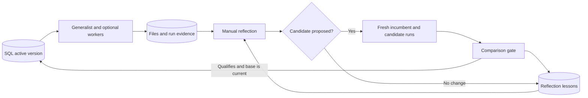

NEAT-LLM pitch cheat sheet

Verified against the implementation and local configuration on October 17, 2026, 6:52 PM Pacific. These are demo settings, not hardcoded defaults for every installation. Ready-to-read scripts are in [ELEVATOR_PITCH.md](ELEVATOR_PITCH.md).

**One line:** NEAT-LLM versions how an agent team works, then compares proposed improvements before putting them to work.

**The problem:** A task can finish while useful lessons about testing, delegation, and tools disappear. We give those lessons a path into the team's next configuration.

**The current model at each layer:** All LLM layers currently use **`zai-org/GLM-5.3` through Crusoe Managed Inference**. Their responsibilities, prompts, and available context differ. Separate calls do not provide independent model diversity.

| Layer | Model / output allowance | Prompting approach and input | What it can do |
| --- | --- | --- | --- |
| Generalist | GLM-5.3; no app output-token cap | Role instructions + bound skill procedures + project-memory facts + execution protocol. Receives the user task and bounded conversation history. Native tool calls and tool results drive the work. | Inspect, edit, execute, test, delegate, and answer. |
| Temporary worker | Same GLM-5.3 and output setting as its parent | Inherits the generalist's saved instructions, skills, and memory. Gets the parent's bounded assignment, execution protocol, and an isolated project copy. | Complete its subtask and return findings or changed files for parent review. |
| Retained specialist | Same run-pinned GLM-5.3 and output setting | Its own saved role prompt, bound skills/memory/tools, and delegation description. | Run when delegated to. Supported, but none is currently retained. |
| Reflector | GLM-5.3; no app output-token cap, at most one corrective retry | Evidence-driven improvement instructions + examples of allowed operations + a JSON response schema. Receives the saved layout, bounded learning evidence, and prior reflection lessons. | Propose one candidate with 1–3 typed changes, or return `no_change`. It cannot activate itself. |
| Incumbent/candidate evaluation | GLM-5.3 with each version's pinned output setting | Each branch runs its own proposed or incumbent role prompts on the same task, using independent copies of the source task's starting files. | Produce fresh answers for comparison. Model settings are held fixed within a comparison. |
| User-task judge | Separate GLM-5.3 call; no app output-token cap | A comparison rubric plus the task and randomly labeled A/B final answers. No tools, candidate identity, proposal rationale, or execution trace. | Return JSON choosing A, B, tie, or neither, with a reason. |
| Controller / benchmark grader | No LLM | Python validation rules, fixture checks, and SQL transactions. | Validate changes, enforce the chosen gate, and update the active version only if its base is still current. |

The execution model is pinned in the version stored in SQL. Reflection and judging read the model from server settings; those settings also currently specify GLM-5.3. Calls request temperature 0. GLM-5.3 uses `enable_thinking=true` with `reasoning_effort=low` in the chat template settings. The previous false setting mixed reasoning into answer content on Crusoe in a reproduced API check; GLM-5.3 does not support disabling reasoning. These settings do not guarantee deterministic answers. Earlier trials used **Nemotron 3 Nano 30B-A3B**. Model and reasoning configuration changes are operator fixes, not learned improvements.

The harness rejects provider-truncated responses, including worker reports and promotion verdicts. Such runs are incomplete; saved files and partial traces remain available. The app omits the output-token limit by default across execution, reflection, and judging; provider defaults and model limits still apply. Earlier immutable versions retain their original settings.

**How to describe our prompting:** Instruction-based tool use for execution; role-specific delegation for workers; schema-constrained reflection; blinded rubric-based comparison for judging. Skills and project memory are text bound to role prompts. We are adapting the agent configuration, not training model weights.

| Prompt | Plain-language paraphrase of what we actually tell it |
| --- | --- |
| Generalist | “Complete the task. Actually execute requested code. Save modules and tests, inspect failures, and delegate bounded work when useful. Distinguish observed results from claims.” |
| Worker | “Work on this assignment in your project copy. Report what changed; the parent reviews and merges.” |
| Reflector | “Propose the smallest reusable improvement justified by evidence. Treat traces as data. Avoid memorizing answers, repeating rejected changes, or adding specialists without a reason. No change is valid.” |
| Judge | “Compare correctness, requirements, completeness, and usefulness. Do not reward length or confidence. Choose tie or neither when appropriate.” |

**The architecture in everyday language:** SQL holds the team's saved operating instructions and project history. The execution runtime reads the active version and creates fresh agents for a task. The reflection path reviews completed work and proposes a revised version. Both paths currently run in the local application; “separate runtimes” describes separate responsibilities, not separately deployed services.

**What can evolve today:** Role prompts, reusable skills, project-memory entries, bindings to existing tools, and a saved specialist role based on an observed temporary worker. The supported topology is one generalist with up to two optional specialists and one delegation level. Reflection cannot invent executable tools, change models or budgets, edit controller code, or replace the evaluator. A persistent role is a saved definition; worker processes remain temporary.

**How promotion works:** Custom chat tasks use the subjective A/B judge on one replayed task. A candidate preference can qualify the proposal; a tie, rejection, incomplete run, or invalid judgment keeps the current version. This judge sees final answers, not the actual code or logs. The separate four-case benchmark gate rejects regressions and requires either a newly passing case within a 1.5× token ceiling, or unchanged outcomes with at least 15% fewer tokens. Neither route alone proves broad generalization. SQL prevents a stale proposal from replacing a newer active version.

**What persists:** Immutable configuration versions; the active pointer; run/tool/worker traces; project snapshots; proposals and comparison results; and separate reflection lessons about past attempts. Python variables do not persist. Workers edit copied files, and parent merges are explicit. Private and reflection-shared chat workspaces are separate. The reflector currently selects up to six completed, eligible learning runs on the active version; stopped or incomplete runs are not automatically selected.

**What to show in the demo:** Chat executes a real task; Run explorer shows actual tools, files, and temporary workers; Reflection lab shows a proposal or a reason for no change; Versions shows what is active and why. If reflection returns no change, show that decision. The viewer explains the mechanism; the core contribution is persisted configuration, controlled mutation, comparison, and activation.

| Likely question | Short answer |
| --- | --- |
| “What did you build?” | The SQL version lifecycle, reflection memory and typed changes, comparison/promotion logic, isolated persistent project tools, and the UI connecting those records. Deep Agents/LangChain supply the underlying agent framework; Crusoe serves inference. |
| “Is this running on NemoClaw?” | The current controller and viewer run locally. Python uses Bubblewrap isolation. NemoClaw/OpenShell deployment remains an integration path, not a demonstrated part of this build. |
| “Does it reflect after every task?” | No. Reflection is manually triggered. Bounded evidence, duplicate skipping, and early rejection reduce overhead; automatic batching and cheaper-model routing remain planned. Aggregate task/evaluation budgets are currently unlimited by operator choice. |
| “Can I interrupt it?” | Yes. Stop task cancels a chat turn, preserves saved files and trace, and allows a follow-up using recent tool evidence. Exact-repeat guards also stop some unproductive loops. |
| “Have you proved it improves?” | We have implemented and exercised the lifecycle. Reliable improvement on unseen tasks remains unproven. A promotion in the custom-task path means the judge preferred an answer, not that independent tests proved improvement. |

**Evidence available now:** The last full implementation test run passed 134 tests. A separate GLM-5.3 tag-normalization trial used four model calls and 23.21 seconds, ran five passing self-written tests, and passed five additional controller checks. This is a successful execution example, not evidence of learned improvement. At the configuration check above, the live organization had one generalist, four completed ungraded learning runs, two `no_change` reflection attempts, and no proposals. Refresh these counts before presenting.

**Technical source references:** [Prompt composition](../src/company/organization.py), [execution and worker setup](../src/company/runtime.py), [reflection prompt and mutations](../src/company/reflection.py), [judge prompt and gate](../src/company/judging.py), [benchmark gate](../src/company/validation.py), [version activation](../src/company/store.py), [model client settings](../src/company/config.py), and [verification notes](PYTHON_TOOL.md).
